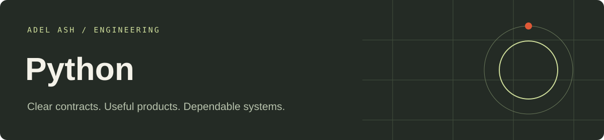

# Python Engineering

Runnable portfolio applications with explicit business rules, browser interfaces and automated checks. Each application has its own folder. All shared source needed by these projects lives inside this repository.

| Application | Folder |
| --- | --- |
| [Financial Reconciliation and Exception Workbench](python/financial-reconciliation-and-exception-workbench-python) | `python/financial-reconciliation-and-exception-workbench-python` |
| [Ecommerce Fulfillment and Exception Portal](python/ecommerce-fulfillment-and-exception-portal-python) | `python/ecommerce-fulfillment-and-exception-portal-python` |
| [Education Assessment and Progress API](python/education-assessment-and-progress-api-python) | `python/education-assessment-and-progress-api-python` |

## Setup and verification

# Python demos

Python 3.12+. From this folder: `python -m venv .venv`, activate it, then `python -m pip install -r requirements.txt`.

FastAPI projects: `python run.py financial-reconciliation-and-exception-workbench-python --port 8000` or use the assessment folder name. Open `http://127.0.0.1:8000` for the workflow console and `/docs` for typed request contracts.

The ecommerce project is Django/DRF with a browser console and transactional CSV imports. Run `python ecommerce-fulfillment-and-exception-portal-python/manage.py runserver 127.0.0.1:8000`.

Data: SQLite, in memory by default. Set `DEMO_DATABASE=local.db` to persist FastAPI/Django workflow state. State/audit access requires `Authorization: Bearer local-operator`. Action requests use the appropriate local fixture role: learner, operator, reviewer or instructor. These explicit development tokens are not real authentication.

Run `python -m pytest -q` here. Tests cover stock concurrency, replay conflicts, rollback on relay failure, callback signatures, approval races, deterministic scoring, deadlines, permissions and persistent reopening.

## Signed finance fixture

From this folder, generate a callback payload without storing a real credential:

```python
import json
from core import Engine
body={"id":"PAY-1","invoice":"INV-100","amount":10000}
print(json.dumps({**body,"signature":Engine().signature(body)}))
```

Paste it into the callback command. The shared signing key is intentionally a local fixture; production secrets must be external and rotated.

Implemented: Python/FastAPI/Pydantic, Django/DRF, SQLite, standard-library HMAC/CSV, pytest. PostgreSQL, Redis, Celery, BotCity, cloud hosting and model services are not live integrations in these local demos.


## Repository guide

- Application READMEs include launch commands, sample inputs and workflow details.
- Architecture documents describe storage and failure boundaries.
- GitHub Actions runs stack-specific checks on changes.
- Local roles and sample records are development examples. Keep them on localhost; configure trusted identity, secrets and operational controls for any public deployment.

## Portfolio

[View this stack’s work](https://adelash.vercel.app/python) · [Email Adel Ash](mailto:tech.dev.workspace@gmail.com)
