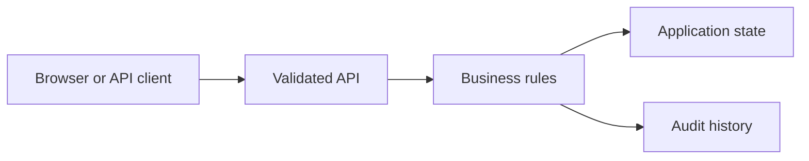

# Ecommerce Fulfillment and Exception Portal

Created a Django REST Framework application service for fulfillment workflows and CSV order imports. Added transactional batch validation, versioned stock reservations, duplicate-event protection and operator actions. Verified import rollback, replay behavior and inventory consistency with pytest against local SQLite data.

## Run locally

Start from the `python/` directory of this repository.

```sh
python ecommerce-fulfillment-and-exception-portal-python/manage.py runserver 127.0.0.1:8000
```

The browser console is available at `http://127.0.0.1:8000` for API applications. For frontend applications, use the frontend development server described in the setup below.

## Architecture



## Workflow

Available actions: `reserve`, `cancel`, `ship`, `refund`, `relay`.

Open `project.json` for the available commands and example inputs when present. Use the operator role to inspect state and audit history. Retry an accepted command with the same identifier to observe replay behavior; change its payload or expected version to exercise conflict handling.

## Verification

Run the automated checks from the stack directory:

```sh
python -m pytest -q
```

The checks exercise business rules, permission boundaries and failure recovery. Sample records are synthetic. Development credentials are local examples; use managed identity, external secrets and your own deployment controls before exposing services publicly.

## Implementation notes

# Ecommerce Fulfillment and Exception Portal

Reserve against an expected stock version. Repeated keys return the same order; conflicting payloads are rejected. Operator actions ship, cancel or refund, with a retryable event outbox.

## Purpose

Reserve against an expected stock version. Repeated keys return the same order; conflicting payloads are rejected. Operator actions ship, cancel or refund, with a retryable event outbox.

## Run

See the family-level README one directory above for the installed runtime and command. Use this folder's `project.json` to select this application.

## Workflow

Domain: **commerce**. Available commands: reserve, cancel, ship, refund, relay.

The configuration includes request examples. Inspect state and the audit log after a successful command, then retry it or change its version to observe duplicate and concurrency behavior.

## Configuration

Core workflow demo only. Local fixture authentication and local development storage. External cloud services, live AI model calls and production database/broker integrations from the broader CV descriptions are not configured here. Read the family-level README for the actual implemented stack and tests.

## Architecture

[Architecture and failure boundaries](ARCHITECTURE.md). Shared workflow modules and tests are in the parent stack folder.

